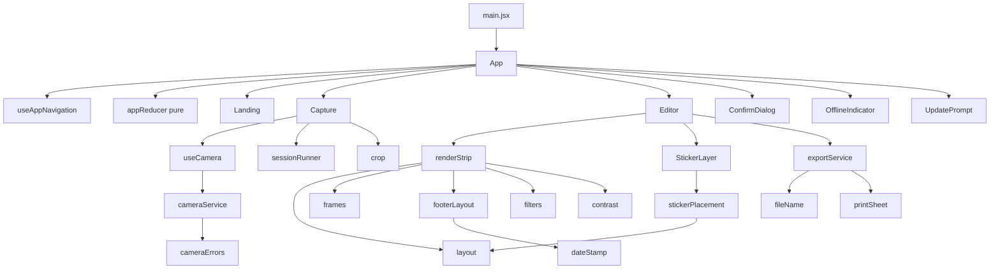
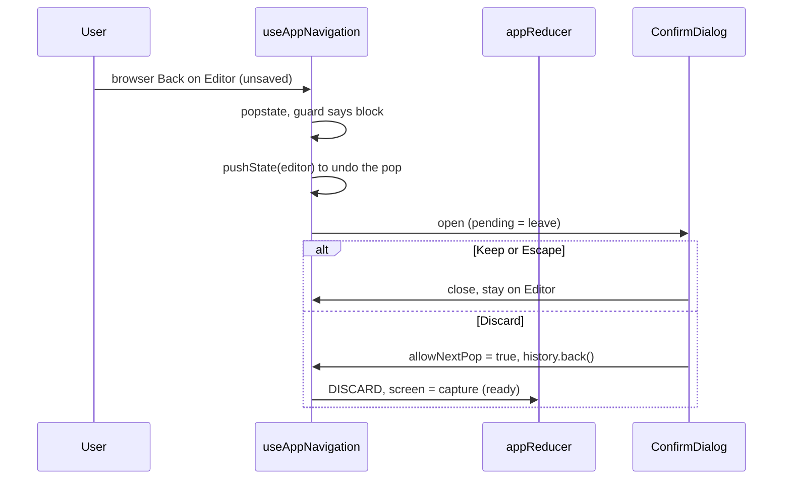

# Design Document

## Overview

This design finishes the Lilim photobooth (React 19 + Vite, plain CSS). It covers only work that is missing or partial in `docs/handoff-from-claude.md` (baseline 2026-11-13). Items marked Done there are preserved. Where Done logic is inline (crop in `Capture.jsx`, filters in `Editor.jsx`), it is extracted into pure modules with the same behavior.

Each design area carries one of three labels:

- **Existing (preserve)**: keep as is. No new work.
- **Refactor**: behavior is kept, code moves or is reshaped.
- **New**: does not exist yet.

### Baseline in the code today

| Fact | Source |
|---|---|
| `App.jsx` holds `screen` (`landing` / `capture` / `editor`) and `photos` (4 JPEG data URLs) in `useState`. No router, no history use. | `src/App.jsx` |
| Photos are 960x720. Strip is 1080x3230: 60 px padding, 30 px gaps, 200 px footer, all blank footer. | `Capture.jsx`, `Editor.jsx` |
| Crop, mirror and the capture loop are inline in `Capture.jsx` (`takePhoto`, `startSession`). Mirroring is unconditional, and the CSS mirrors the preview unconditionally (`.camera video { transform: scaleX(-1) }`). | `Capture.jsx`, `index.css` |
| Filters None, B&W, Sepia, Warm mutate pixel arrays in place inside `Editor.jsx`. They run on the main canvas photo areas. | `Editor.jsx` |
| Editor state (`frameColor`, `filter`) lives in `Editor` and is lost when it unmounts. | `Editor.jsx` |
| CSS has `--bg`, `--ink`, `--accent`, 44 px swatches and chips, a 900 px breakpoint, `100dvh`. | `index.css` |
| `.env` is already listed in `.gitignore`. `package.json` uses `^` ranges and still lists `@supabase/supabase-js` and `qrcode.react`. | `.gitignore`, `package.json` |

### Design decisions

| Decision | Choice | Reason |
|---|---|---|
| Routing | No router library. `history.pushState` / `popstate` inside one `useAppNavigation` hook. | 3 screens. Requirement 9 needs only history entries and guards. |
| App state | One `useReducer` in `App` holds screen, photos, Session_Date, Editor settings, preferences and the unsaved flag. | Editor settings must survive a single-photo retake (R4.4), which unmounts `Editor`. A pure reducer is also easy to test. |
| Sticker selection UI | Selection outline and hit areas are DOM elements over the canvas. The canvas never draws them. | Exports are the canvas itself, so no handle or outline can reach a file (R6.19, R8.1). |
| Sticker geometry | Axis-aligned bounding box (AABB) of the rotated sticker, tested against the 4 Photo_Areas and the strip. | Simple, exact enough, and conservative: a sticker never covers a photo pixel. A rotated sticker may be refused slightly before its true corner touches. |
| Filters | Pure functions `(ArrayLike<number>) => Uint8ClampedArray`. Applied once per photo to an offscreen 960x720 canvas, cached per photo and filter. | Satisfies purity (R7.3-R7.8). Frame, caption and sticker edits redraw without re-running filters, so the 1000 ms budget (R7.10) is easy to meet. |
| Dialogs | Native `<dialog>` with `showModal()`. | Built-in focus trap, Escape handling and inert background. |
| PWA | `vite-plugin-pwa` with `registerType: 'prompt'`, manual registration through `virtual:pwa-register`. | Update must never reload automatically (R17.10). Registration is gated on `window.isSecureContext` (R17.14). |
| Theme | No new visual style. Reuse the existing `--bg`, `--ink`, `--accent` variables and add neutral variables for new needs. | Style notes are pending. The meme template and moving landing text are out of scope. |
| Dependencies | Exact versions only. `.npmrc` gets `save-exact=true`. New packages: `vitest`, `fast-check`, `@testing-library/react`, `@testing-library/user-event`, `@testing-library/jest-dom`, `jsdom`, `vite-plugin-pwa`. Removed: `@supabase/supabase-js`, `qrcode.react`. Versions are resolved at install time with `npm install --save-exact`. | R13.6, R14.1 |

### Findings the owner should know

1. **Sticker space is small.** Stickers may not cover any Photo_Area, so they can only sit in the 200 px footer, the 60 px side and top padding, and the 30 px gaps. A 300% sticker cannot fit anywhere at a default size of 80 px. The design keeps the 25% to 300% slider (R6.9) and clamps to the largest size that is valid at the current position (R6.11). In practice the useful maximum is set by the footer height (about 250% unrotated at 80 px, less when rotated).
2. **Existing button contrast fails R11.7.** White text on `--accent` (`#e8788a`) is about 2.8:1. The design changes only the text color on accent to `--ink` (about 4.8:1) and leaves the accent color alone. An automated palette test enforces this (see Testing Strategy).
3. **Preview crop.** The preview box is 4:3 with `object-fit: cover`, so it shows exactly the region the Crop_Function saves (R10.6). Phones that deliver 3:4 frames therefore show a cropped preview by design, matching the saved photo.

## Architecture

### Module map



Pure modules live in `src/lib/` and import nothing from React or the DOM. Components and hooks live in `src/components/` and `src/hooks/`.

```
src/
  App.jsx                    Refactor   reducer + navigation + global UI
  appReducer.js              New        pure state machine
  lib/
    layout.js                New        strip constants + photoRects()
    crop.js                  Refactor   from Capture.takePhoto
    filters.js               Refactor   from Editor.FILTERS (+4 new filters)
    dateStamp.js             New
    fileName.js              New
    printSheet.js            New
    stickerPlacement.js      New
    footerLayout.js          New        caption fit + footer geometry
    contrast.js              New        contrast ratio + text color pick
    frames.js                Refactor   10 solids kept, 6 new designs
    renderStrip.js           Refactor   from Editor.drawStrip
    exportService.js         New        blob, download, share, print sheet
    cameraService.js         New        start/stop/list/switch
    cameraErrors.js          New        error classification + messages
    sessionRunner.js         New        abortable countdown/capture loop
    describeStrip.js         New        canvas text alternative
  hooks/
    useCamera.js, useAppNavigation.js, useOnlineStatus.js,
    useServiceWorker.js, useReducedMotion.js     New
  components/
    Landing.jsx              Refactor   privacy line, title "Lilim"
    Capture.jsx              Refactor
    Editor.jsx               Refactor
    StickerLayer.jsx, StickerControls.jsx, ConfirmDialog.jsx,
    OfflineIndicator.jsx, UpdatePrompt.jsx, LiveRegion.jsx   New
  assets/stickers/*.svg      New        6 bundled sticker SVGs
public/icons/, favicon.svg   New        placeholder icons
```

### Navigation and history

Each screen change calls `history.pushState({ screen, mode }, '')`. Returning to the previous screen calls `history.back()` so the stack stays `landing, capture, editor` and never grows when the user goes back and forth. `popstate` is the single place that syncs the reducer to the history state and applies the guards.



Rules:

- Capture Back, no session: `history.back()` to Landing, or to Editor in Single_Shot_Mode (R9.2).
- Browser Back during a session: abort the session as Cancel does, then `pushState(capture)` to stay on the screen (R9.3).
- Single-shot completion or cancel: `history.back()` to the Editor entry, which always exists below it (R4.4, R4.6).
- Retake All, unsaved: dialog first. On Discard, `history.back()` to the capture entry. Not unsaved: `history.back()` directly (R9.5).
- Per-photo Retake: `pushState(capture, { single: i })`, no dialog (R9.11).
- Page load with a non-landing `history.state` (reload): `replaceState(landing)`. The state is gone after a reload, so landing is the only valid screen.
- `beforeunload` listener is attached only while `unsaved` is true (R9.9, R9.10). It is removed on export success and after Discard.

## Components and Interfaces

### Layout constants and geometry (New, `lib/layout.js`)

```js
export const PHOTO_W = 960, PHOTO_H = 720, PAD = 60, GAP = 30, FOOTER = 200
export const STRIP_W = 1080, STRIP_H = 3230     // PAD + 4*PHOTO_H + 3*GAP + FOOTER
/** @returns {{x,y,w,h}[]} the 4 Photo_Areas in strip order */
export function photoRects()
export const FOOTER_RECT = { x: 0, y: STRIP_H - FOOTER, w: STRIP_W, h: FOOTER }
```

These replace the copies in `Capture.jsx` and `Editor.jsx`.

### Crop (Refactor, `lib/crop.js`) - R1.8, R1.9

```js
/** Center 4:3 region of a camera frame. Pure. */
export function cropRect(frameW, frameH) // => { sx, sy, sw, sh }
export function isMirrored(trackSettings) // facingMode !== 'environment'
```

Same math as today's `takePhoto`: if the frame is wider than 4:3, crop width and center horizontally, otherwise crop height and center vertically. `isMirrored` returns false only for a rear camera. Desktop webcams report no `facingMode` and count as user-facing. `Capture` toggles a `mirrored` CSS class on the video (R3.8); the inline `scaleX(-1)` CSS rule becomes `.camera video.mirrored`.

### Camera (New, `lib/cameraService.js`, `lib/cameraErrors.js`, `hooks/useCamera.js`) - R2, R3.6, R3.7, R3.9

```js
// cameraErrors.js (pure)
export function classifyCameraError(err) // => 'denied'|'not-found'|'in-use'|'overconstrained'|'disconnected'|'insecure'|'unknown'
export const CAMERA_MESSAGES // code => { text, steps?: string[] }

// cameraService.js
export function isCameraAvailable(win)                 // isSecureContext && getUserMedia exists
export async function startCamera({ deviceId } = {})   // retries once on OverconstrainedError with { video: true }
export function stopStream(stream)                     // stops every track
export async function listVideoInputs()                // enumerateDevices filtered to videoinput
export function nextDeviceId(devices, currentId)       // cyclic, list order (pure)
```

Name mapping: `NotAllowedError`/`PermissionDeniedError` to `denied`, `NotFoundError`/`DevicesNotFoundError` to `not-found`, `NotReadableError`/`TrackStartError` to `in-use`. The `denied` message includes step-by-step re-enable instructions. The first start keeps today's constraints (`facingMode: 'user'`, ideal 1280x960). After a switch, constraints use `deviceId: { exact }`.

`useCamera` returns `{ status, error, stream, videoInputs, mirrored, start, retry, switchCamera }`:

- `status`: `idle | starting | ready | error`.
- `retry` and `switchCamera` ignore calls while a request is in flight (an `inFlight` ref). This gives exactly one camera request per Try Again press (R2.9) and a disabled button while pending (R2.10). The first request on mount comes from the effect, as today, including the `cancelled` guard for StrictMode.
- Before each request, the previous stream is stopped (R2.9).
- Each video track gets an `ended` listener that sets `error = 'disconnected'` and aborts any running session (R1.5, R2.6, R2.7). `devicechange` refreshes `videoInputs`.
- The Switch Camera button is shown when `videoInputs.length > 1` (R3.6). A failed switch sets the error state with Try Again (R3.9).

### Session runner (New, `lib/sessionRunner.js`) - R1.2-R1.5, R3.3-R3.5, R4.3

```js
export function waitForVideoReady(video, { timeoutMs = 5000, signal }) // resolves when videoWidth/Height > 0, rejects 'timeout' or 'aborted'
export function abortableSleep(ms, signal)
export async function runSession({ shots, countdownSec, signal, capture, onCount, onShot, sleep })
// => string[] of data URLs; rejects with AbortError when cancelled
```

`Capture` creates one `AbortController` per session. Cancel, browser Back, stream `ended` and unmount all call `abort()`. Abortable sleep rejects at once, so the loop stops well inside 500 ms (R3.4). `runSession` returns a fresh array only on full completion; on abort the partial array is dropped (R1.5, R12.5). `shots` is 4 in a full Session and 1 in Single_Shot_Mode. The countdown choices (3, 5, 10) and selected device come from app preferences and are disabled while a session runs (R3.5).

### Filters (Refactor, `lib/filters.js`) - R7

```js
export const FILTERS = { none, bw, sepia, warm, cool, vintage, contrast, fade } // key => { label, apply }
// apply(pixels: ArrayLike<number>) => Uint8ClampedArray (new array, same length)
```

Existing None, B&W, Sepia and Warm keep their formulas but stop mutating. Each filter reads an RGBA array and returns a new `Uint8ClampedArray`, which rounds and clamps to 0..255 integers. Alpha bytes are copied unchanged. New filters:

| Filter | Operation |
|---|---|
| Cool | red x0.88, blue x1.08 + 8 (mirror of Warm) |
| Vintage | sepia blend (60%) then lower contrast and a slight green-yellow lift |
| High Contrast | `(v - 128) * 1.4 + 128` per channel |
| Soft Fade | `v * 0.85 + 38` per channel (raised blacks, lowered whites) |

B&W uses luma weights 0.299/0.587/0.114, which sum to 1, so a second pass returns the same integers (idempotence). `None` returns a copy.

`useFilteredPhotos(images, filterKey)` (inside `Editor`) keeps four offscreen 960x720 canvases. It recomputes all four when the filter changes and one when a photo is replaced. Originals are never modified, so None restores them exactly (R7.9).

### Frames (Refactor, `lib/frames.js`) - R6.1-R6.4

```js
export const SOLID_COLORS = [ /* the existing 10, unchanged */ ]
export const FRAMES // [{ id, label, kind: 'solid'|'pattern'|'gradient', paint(ctx, w, h), footerColors: string[] }]
```

Existing 10 solids stay as solids. New designs: patterns `dots`, `stripes`, `checks`; gradients `gradient-a`, `gradient-b`, `gradient-c`. Colors reuse the existing palette (no new theme). `paint` draws behind the photos and the footer. A custom picked color becomes a solid frame `{ kind: 'custom', color }` that replaces the selected design (R6.3). `footerColors` lists the distinct colors that can appear under the footer text (base, pattern color, gradient end points) for the contrast rule.

### Footer: caption and date (New, `lib/footerLayout.js`, `lib/dateStamp.js`, `lib/contrast.js`) - R5

```js
// dateStamp.js
export function formatDateStamp(date)  // "Nov 13, 2026" (fixed English month table, no Intl)
export function parseDateStamp(str)    // => { year, month, day } | null

// footerLayout.js
export const CAPTION_MAX = 40, CAPTION_SIZE = 48, CAPTION_MIN_SIZE = 16, DATE_SIZE = 32
export function fitCaption(measure, text, maxWidth, size = CAPTION_SIZE, min = CAPTION_MIN_SIZE)
  // => { text, fontSize }  shrinks to min, then truncates with an ellipsis
export function footerLayout({ hasCaption, showDate })
  // => { caption?: { cx, baselineY, boxTop, boxBottom }, date?: { ... } }  all inside FOOTER_RECT, no overlap

// contrast.js
export function contrastRatio(hexA, hexB)       // WCAG 2.x
export function pickTextColor(colors)           // '#000000' or '#ffffff', the one with the best worst-case contrast
```

`maxWidth = STRIP_W - 2 * PAD` (960 px). `fitCaption` takes an injected `measure(text, size)`, so it runs without a canvas. `Editor` clamps the input with `maxLength={40}`. Text is centered horizontally. With both lines shown, the caption box sits above the date box inside the 200 px footer. With neither, the footer layout is empty (R5.10). Text color is `pickTextColor(frame.footerColors)`. Built-in frames are tested to reach 4.5:1 (R5.11), and any custom solid color always can, because black or white reaches at least 4.58:1 against a single color.

### Stickers (New, `lib/stickerPlacement.js`, `components/StickerLayer.jsx`, `components/StickerControls.jsx`) - R6.5-R6.23

Coordinates are strip canvas pixels. A sticker is a square of `STICKER_BASE = 80` px at scale 1. Its half-extent for scale `s` and rotation `θ` is `h = (80 * s / 2) * (|cos θ| + |sin θ|)`, the same on both axes. Flip does not change the extent.

```js
export const STICKER_BASE = 80, MAX_STICKERS = 10, SCALE_MIN = 0.25, SCALE_MAX = 3
export function halfExtent(scale, rotationDeg)
export function isValid(t)                       // inside strip AND no overlap with any Photo_Area (touching is allowed)
export function placeNew(kind, id)               // nearest valid center to strip center, default size, rotation 0, no flip; null if none
export function moveTo(prev, targetX, targetY)   // drag: slide along edges, never overlaps
export function clampScale(t, requestedScale)    // largest valid scale <= request, within [0.25, 3]
export function clampRotation(t, requestedDeg)   // walks 1 degree steps from the last valid angle, stops at first invalid
export function keyboardMove(t, dx, dy)          // moveTo with 10 px steps
export function normalizeAngle(deg)              // 0..359
```

Algorithms:

- **Overlap rule.** A center `(x, y)` with half-extent `h` is valid when `h <= x <= W - h`, `h <= y <= H - h`, and for every Photo_Area the center lies outside the open rectangle `(left - h, right + h) x (top - h, bottom + h)`. Sticker pixels may touch a photo edge but never cover a photo pixel.
- **Drag with slide (`moveTo`).** Start from the last valid center `p`. Clamp the target to the strip bounds. Move along x at the current y: for each Photo_Area whose expanded y-range contains `p.y`, stop at the first expanded left or right edge crossed. Then move along y at the resulting x with the same rule. Because the path starts valid and each axis move stops at the first obstacle, the result is always valid, and a sticker pushed against a photo keeps sliding along its edge on the free axis (R6.8).
- **Nearest valid position (`placeNew`).** The valid region is a union of rectangles, so the closest valid point to the strip center has each coordinate equal to the target coordinate or to an expanded-rectangle or strip-bound edge. Build the candidate x and y lists from those values, test every pair with `isValid`, and take the nearest. A `null` result means "no space" (R6.17).
- **Resize.** Validity is monotonic in scale at a fixed center (a larger box only adds overlap), so `clampScale` bisects between the current valid scale and the request.
- **Rotate.** Validity is not monotonic in angle. `clampRotation` steps 1 degree at a time from the previous valid angle toward the request and stops before the first invalid angle (R6.11).
- **Pinch and twist.** On two active pointers, the scale ratio and angle delta since gesture start become `clampScale` and `clampRotation` requests.

`StickerLayer` is a div positioned over the canvas with the same aspect ratio. It maps client coordinates to strip coordinates by `strip / boundingClientRect.width`, so on-screen scale never changes stored transforms (R6.19). Each sticker has a transparent hit element (`role="button"`, `tabIndex=0`, accessible name such as "Star sticker, selected") with `touch-action: none` (R6.20). The element is positioned and rotated with CSS and shows an outline only when selected. Pointer events use `setPointerCapture`. Keys on a focused sticker: arrows move 10 px, `+` / `-` resize by 10%, `Delete` removes it. Tapping the layer background clears the selection (R6.14).

`StickerControls` provides: sticker palette (6 buttons), size slider (25-300%), rotation slider (0-359), rotate left / right 15 degree buttons, Flip, Delete, Remove All, and a message region for the 10-sticker limit and "no space" notices (R6.15-R6.17). All have accessible names.

Sticker images are 6 square SVGs in `src/assets/stickers/`, imported with Vite's `?url` and decoded once into `Image` objects (each SVG has explicit `width` and `height`). They are neutral shapes (star, heart, circle, sparkle, flower, bolt) and not a visual theme.

### Strip rendering (Refactor, `lib/renderStrip.js`) - R5, R6.18, R6.19, R7.2

```js
export function renderStrip(ctx, { frame, photoCanvases, caption, showDate, sessionDate, stickers, stickerImages })
```

Draw order: frame, photos (already filtered), footer text, stickers. Stickers come last, so filters never change sticker pixels (R6.18, R7.2). For each sticker: translate to center, rotate, scale by `(flipped ? -1 : 1)` on x, and draw. The same function renders the screen canvas and the export, so there is no second code path. The canvas stays 1080x3230 and CSS scales it (R10.7).

### Export and share (Refactor, `lib/exportService.js`, `lib/fileName.js`, `lib/printSheet.js`) - R8

```js
export function exportFileName(date, prefix = 'lilim-strip', ext = 'png')   // lilim-strip-YYYYMMDD-HHmmss.png, local 24 h time
export function printSheetLayout(sheetW, sheetH, stripW, stripH)            // => { scale, x, y, w, h }
export function canvasToBlob(canvas)                                        // rejects when toBlob gives null
export async function downloadStrip(canvas, now)
export async function downloadPrintSheet(canvas, now)                       // 1200x1800, white background
export function canShareImages(nav)                                         // nav.canShare({ files: [dummy png] })
export async function shareStrip(canvas, nav, now)                          // resolves 'shared' | 'dismissed'; throws otherwise
```

- `printSheetLayout` uses `scale = min(sheetW / stripW, sheetH / stripH)`, centers the result, and never crops. For this strip the height limits the scale (about 0.557, 602x1800 px).
- Download builds a blob (as today), names it with `exportFileName`, clicks a temporary anchor and revokes the URL after the click.
- `AbortError` from `navigator.share` returns `'dismissed'` with no message (R8.5). Any other error shows "Sharing failed. Use Download instead." (R8.6).
- A `null` blob or a thrown error shows an error message and leaves state unchanged (R8.7, R8.10).
- On success the `Editor` dispatches `EXPORTED` (clears `unsaved`) and writes to a polite live region (R11.11). The Share button also works offline (R17.4).

### Editor screen (Refactor, `components/Editor.jsx`) - R4.1, R4.8, R5, R6, R7, R8

`Editor` becomes a controlled component. Its settings (frame, filter, caption, showDate, stickers, selectedId) come from `App` state and change through reducer actions. It keeps only local transient state (decoded images, filtered canvases, status messages).

Controls added: per-photo Retake buttons "Retake photo 1" to "Retake photo 4" (R4.1), Retake All (R4.8), caption input, date toggle, 16 frames plus custom picker, 8 filters, sticker controls, Download, Share (when `canShareImages`), Download Print Sheet. The existing swatch, custom picker and chip markup is kept (Existing, preserve).

The canvas has `role="img"` and `aria-label={describeStrip(state)}` (R11.6). `describeStrip` is pure and lists photo count, filter, frame, caption, date, and sticker count.

### Capture screen (Refactor, `components/Capture.jsx`) - R1, R2, R3, R4.3

Props: `{ mode: 'full' | { single: index }, prefs, onPrefs, onDone, onBack, onSessionRunning }`. The component keeps today's markup and loop structure but delegates to `useCamera` and `runSession`.

- Start waits through `waitForVideoReady` (5 s timeout) before the first countdown (R1.3, R1.4).
- A polite live region announces each countdown number and "Photo N of 4" (R11.4). Under Reduced_Motion_Preference the animation is off but the number still renders and is announced (R11.8).
- Error view: message (`role="alert"`), Try Again (disabled while pending) and Back. Back is kept (R2.2, Existing).
- Controls: timer choice (3 / 5 / 10 s, default 3), Cancel (visible while running), Switch Camera, Start. Timer choice and Switch Camera are disabled while running. Back is disabled while running because Cancel is the exit.
- On completion it calls `onDone(shots)` with exactly 4 photos of 960x720 (or 1 in single mode).
- Resize and rotation do not touch captured shots: they live in the session closure, not in layout state (R10.8).

### App shell (Refactor, `App.jsx`, `appReducer.js`, `hooks/useAppNavigation.js`) - R4, R9, R12.4

Reducer actions: `START`, `SESSION_DONE(photos)`, `SINGLE_DONE(index, photo)`, `SINGLE_CANCEL`, `RETAKE_ONE(index)`, `RETAKE_ALL`, `DISCARD`, `SET_FRAME`, `SET_FILTER`, `SET_CAPTION`, `SET_SHOW_DATE`, `STICKER_ADD/MOVE/SCALE/ROTATE/FLIP/DELETE/CLEAR/SELECT`, `EXPORTED`, `SET_PREFS`, `SESSION_RUNNING(bool)`.

Behavior:

- `SESSION_DONE` sets photos, a new `sessionDate`, default Editor settings, and `unsaved = true`.
- `SINGLE_DONE` replaces one photo only and keeps `sessionDate` and every Editor setting (R4.4, R4.5). `SINGLE_CANCEL` changes nothing (R4.6).
- Every Editor action sets `unsaved = true`. `EXPORTED` sets it to false. A later Editor change sets it again.
- `RETAKE_ALL` and `DISCARD` reset photos, `sessionDate`, and Editor settings to defaults, and drop all references to photos and stickers in the same dispatch (R12.4). `prefs` (countdown, deviceId) are not reset. Retake All gets a new `sessionDate` when its capture completes.
- `ConfirmDialog` is opened by `App` with a pending action (`leave`, `retakeAll`, `reload`). Discard runs the action. Keep and Escape close it (R9.6, R9.8). The `reload` action is guarded when `unsaved` or `capturing` is true (R17.12).

### Dialog, offline and update UI (New) - R9, R17.8-R17.12, R11.5

- `ConfirmDialog`: `<dialog>`, Discard and Keep buttons, `cancel` event (Escape) calls Keep, initial focus on Keep.
- `useOnlineStatus` + `OfflineIndicator`: listens to `online` / `offline` and reads `navigator.onLine`. Renders a banner with text ("You are offline. Everything still works.") using `role="status"`. It does not block any control (R17.8, R17.9).
- `useServiceWorker` + `UpdatePrompt`: wraps `registerSW({ onNeedRefresh })`. Shows a banner with a Reload button. Reload goes through the guard above, then calls `updateSW(true)`. Registration only runs when `window.isSecureContext`. Registration failure and offline update-check failure are caught and show nothing (R17.14-R17.16).
- `LiveRegion`: one polite `aria-live` element for countdown and export results. Errors use `role="alert"`.

### PWA, build and hosting (New) - R13, R16, R17

`vite.config.js`:

```js
const base = process.env.BASE_PATH ?? '/'
export default defineConfig({
  base,
  plugins: [react(), VitePWA({
    registerType: 'prompt', injectRegister: null,
    manifest: { name: 'Lilim', short_name: 'Lilim', start_url: base, scope: base,
                display: 'standalone', theme_color, background_color,
                icons: [192, 512, 512 maskable] },
    workbox: { globPatterns: ['**/*.{js,css,html,svg,png,woff2,webmanifest}'], navigateFallback: 'index.html' },
  })],
  test: { environment: 'jsdom', setupFiles: './src/test/setup.js', globals: true },
})
```

- `theme_color` and `background_color` come from one exported constant used by the manifest, and a smoke test checks that it equals the `theme-color` meta in `index.html` (R11.9). Values are neutral placeholders (existing `--bg` / `--ink`), replaced when style notes arrive.
- No runtime caching rules exist. The app never fetches photo data, so the Service_Worker cache holds only build assets (R12.1, R17.13).
- `index.html`: title and Landing title "Lilim", meta description (1-160 chars), `theme-color`, favicon link, `viewport-fit=cover` added to the viewport meta (R10.5, R11.9, R11.12).
- Hosting is unnamed. The design fixes only the contract a host config must meet: HTTP redirects to HTTPS, `sw.js` served with `Cache-Control: no-cache`, `manifest.webmanifest` served as `application/manifest+json`, `sw.js` as JavaScript (R16.5-R16.7). The Hosting_Configuration file is produced once the owner names the host (R16.2). `BASE_PATH` handles sub-path hosting (R16.3).
- Icons: placeholder 192, 512 and 512 maskable PNGs in `public/icons/` (neutral monogram), replaced when the style is decided.

### Styling, responsiveness and accessibility (Refactor, `index.css`) - R10, R11

All changes extend the existing stylesheet. No theme is introduced.

- Variables: keep `--bg`, `--ink`, `--accent`. Add `--on-accent` (set to `--ink`), `--focus`, `--surface-muted`, `--space`. Text on `.btn` uses `--on-accent`.
- Focus: `:focus-visible { outline: 3px solid var(--focus); outline-offset: 2px }`, with `--focus` at 3:1 or better on `--bg` and on swatches (R11.2).
- Safe areas: `.screen { padding: max(16px, env(safe-area-inset-top)) max(16px, env(safe-area-inset-right)) max(16px, env(safe-area-inset-bottom)) max(16px, env(safe-area-inset-left)) }` (R10.5).
- Short landscape: `@media (orientation: landscape) and (max-height: 500px)` puts the camera and controls in a row. The camera width is `min(480px, (100dvh - 32px) * 4 / 3)`, so preview, countdown, Start and Cancel fit without scrolling (R10.3).
- Strip: the wrapper width is `min(100%, 300px, (100dvh - 32px) * 1080 / 3230)` with `aspect-ratio: 1080 / 3230`. Strip above controls under 900 px, beside them at 900 px and wider (existing breakpoint, preserved). The sticker layer uses the same box.
- Touch targets: sticker buttons, sliders, toggles and the new chips are at least 44x44 px under 900 px. Sliders get a 44 px tall hit area.
- No horizontal scroll: `min-width: 0` on flex children, `max-width: 100%` on media, long labels wrap (R10.1).
- Reduced motion: `@media (prefers-reduced-motion: reduce) { .countdown, .flash, * { animation: none; transition: none } }`. The flash becomes a non-animated, brief state or is omitted (R11.8).
- Contrast: `--ink` on `--bg`, `--on-accent` on `--accent`, offline banner colors, and focus color are checked by the palette test (R11.7, R17.8).

### Landing and privacy (Refactor, `components/Landing.jsx`) - R11.12, R12.6

Title "Lilim" (was "Lilim Photobooth"), tagline kept, and a visible privacy line of at most 120 characters: "Your photos stay on this device. Nothing is uploaded." (53 characters). The same sentence is the base for the README's full privacy statement.

### Requirement coverage by area

| Area | Label | Requirements |
|---|---|---|
| Crop, mirror rule | Refactor | R1.8-R1.10, R3.8 |
| Camera service, errors, retry, switch | New | R1.3-R1.6, R2, R3.6, R3.7, R3.9 |
| Session runner, Cancel, timer | New | R1.1-R1.2, R1.7, R3.1-R3.5, R4.3 |
| Capture preserved items (4 photos, one loop, track stop, back on error) | Existing (preserve) | R1.1, R1.6, R2.2 |
| Filters (4 existing, 4 new) | Refactor + New | R7 |
| Frames: 10 solids and picker | Existing (preserve) | R6.3 |
| Frames: patterns, gradients | New | R6.1, R6.2, R6.4 |
| Caption, date, contrast | New | R5 |
| Stickers | New | R6.5-R6.23 |
| Export: PNG via toBlob | Existing (preserve) | R8.1 |
| Export: file name, share, print sheet, errors | New | R8.2-R8.10 |
| Reducer, history, dialog, beforeunload | New | R4, R9, R12.4 |
| Responsive CSS | Existing (preserve) + Refactor | R10 |
| Accessibility, metadata | Refactor + New | R11 |
| Privacy | Existing behavior + New line | R12 |
| Dependency cleanup, pins | New | R13 |
| Tests | New | R14 |
| README | New | R15 |
| Build and hosting contract | New | R16 |
| PWA, offline, update | New | R17 |

## Data Models

```js
// App state (appReducer)
{
  screen: 'landing' | 'capture' | 'editor',
  captureMode: 'full' | { single: 0|1|2|3 },
  photos: string[],            // [] or 4 JPEG data URLs, 960x720, strip order
  sessionDate: number | null,  // epoch ms, set when a full Session completes
  editor: EditorSettings,
  unsaved: boolean,
  capturing: boolean,          // a Session is running (for the reload guard)
  prefs: { countdownSec: 3|5|10, deviceId: string | null },
  nextStickerId: number,
}

// EditorSettings (defaults from defaultEditorSettings())
{
  frame: { kind: 'design', id: string } | { kind: 'custom', color: '#rrggbb' },  // default: white solid
  filter: 'none' | 'bw' | 'sepia' | 'warm' | 'cool' | 'vintage' | 'contrast' | 'fade',
  caption: string,             // 0..40 chars
  showDate: boolean,           // default true
  stickers: Sticker[],         // max 10, array order = draw order
  selectedId: number | null,
}

// Sticker_Transform + identity
{ id: number, kind: string, x: number, y: number,   // center, strip px
  scale: number,               // 0.25..3
  rotation: number,            // integer 0..359 degrees
  flipped: boolean }

// Value types returned by pure modules
CropRect     = { sx, sy, sw, sh }
Rect         = { x, y, w, h }
FooterLayout = { caption?: BoxInfo, date?: BoxInfo }
PrintLayout  = { scale, x, y, w, h }
DateParts    = { year, month, day }        // month 1..12
CameraError  = 'denied'|'not-found'|'in-use'|'overconstrained'|'disconnected'|'insecure'|'unknown'
```

Storage rules: none of this state is written to `localStorage`, `sessionStorage`, IndexedDB, cookies or any cache (R12.1). Photos exist only in memory as data URLs. When photos are discarded, the reducer drops the strings, `Editor` unmount sets offscreen canvas sizes to 0, and decoded `Image` references are cleared.

## Correctness Properties

A property is a characteristic or behavior that should hold true across all valid executions of a system, a formal statement about what the system should do. Properties serve as the bridge between human-readable specifications and machine-verifiable correctness guarantees.

Redundancy review: several prework items were merged. Filter range, length, alpha and determinism (R7.4-R7.6, R7.9) became one property because they share one generator and one set of filters. Cancel and camera-failure return in single mode (R4.6, R4.7) share one reducer transition. The no-dialog and dialog rules (R9.4, R9.5, R9.9-R9.11, R17.12) are all the same guard predicate. Discard and Retake All resets (R12.4) are one reset property. Resize and rotate clamping (R6.9-R6.11) stay as two properties because validity is monotonic in scale but not in angle. Mirroring (R1.10, R3.8) is one property.

### Property 1: Crop rectangle is a centered 4:3 region inside the frame

For any camera frame with positive width and height, `cropRect` returns a rectangle that lies entirely inside the frame, is centered on the frame along the cropped axis (and spans the full frame on the other), and has a width-to-height ratio of 4:3 within a tolerance of 1 px.

**Validates: Requirements 1.8, 1.9**

### Property 2: Mirroring follows the camera facing mode

For any track settings object, `isMirrored` returns false exactly when `facingMode` is `'environment'`, and true for `'user'` and for settings with no `facingMode`.

**Validates: Requirements 1.10, 3.8**

### Property 3: Camera errors map to a stable code

For any error name, `classifyCameraError` returns `denied` for `NotAllowedError` / `PermissionDeniedError`, `not-found` for `NotFoundError` / `DevicesNotFoundError`, `in-use` for `NotReadableError` / `TrackStartError`, `overconstrained` for `OverconstrainedError`, and `unknown` for every other name. Every code has a distinct non-empty message.

**Validates: Requirements 2.1, 2.3, 2.4, 2.5, 2.11**

### Property 4: Next camera is cyclic in list order

For any non-empty list of video inputs and any current device in the list, `nextDeviceId` returns the device at the next index modulo the list length, and applying it as many times as the list length returns to the starting device.

**Validates: Requirements 3.7**

### Property 5: Single retake replaces only the selected photo

For any app state with 4 photos, any index 0..3 and any new photo, applying `SINGLE_DONE` produces a state where only `photos[index]` changed, and `sessionDate`, every Editor setting (frame, filter, caption, showDate, stickers) and the preferences are unchanged.

**Validates: Requirements 4.4, 4.5**

### Property 6: Cancelling a single retake changes nothing

For any app state in single capture mode, applying `SINGLE_CANCEL` returns the Editor screen with photos, `sessionDate` and every Editor setting equal to their previous values.

**Validates: Requirements 4.6, 4.7**

### Property 7: Caption never exceeds 40 characters

For any string, `SET_CAPTION` stores a caption of at most 40 characters that is a prefix of the input.

**Validates: Requirements 5.1**

### Property 8: Date stamp format

For any valid date, `formatDateStamp` returns a string matching `^[A-Z][a-z]{2} [1-9]\d?, \d{4}$` whose month text is the English 3-letter month of the date, whose day has no leading zero, and whose year is the 4-digit year.

**Validates: Requirements 5.4, 5.5**

### Property 9: Date stamp round trip

For any valid date, parsing the output of `formatDateStamp` yields the same year, month and day.

**Validates: Requirements 5.6**

### Property 10: Caption fitting

For any caption text, available width and monotonic text measure, `fitCaption` returns a font size between 16 and 48. If the text is not truncated, its measured width at the returned size is at most the available width, and the size is the largest size at or below 48 that fits. If the text is truncated, the size is 16, the text ends with an ellipsis, and its measured width at 16 px is at most the available width.

**Validates: Requirements 5.7, 5.8**

### Property 11: Footer layout stays inside the footer without overlap

For any combination of caption shown and date shown and any caption font size from 16 to 48, `footerLayout` returns boxes that lie inside the footer rectangle, are horizontally centered on the strip, and do not overlap each other, with the caption above the date when both exist. When neither is shown it returns no boxes.

**Validates: Requirements 5.2, 5.9, 5.10**

### Property 12: Footer text is readable on any solid frame color

For any custom solid color, the color chosen by `pickTextColor` has a contrast ratio of at least 4.5:1 against that color. For every built-in frame, the chosen text color has at least 4.5:1 against every color in the frame's `footerColors`.

**Validates: Requirements 5.11**

### Property 13: Frame change does not alter photo areas

For any two frames and any four photos, `renderStrip` issues the same photo draw calls (source, position and size) for both frames, and draws the frame before any photo.

**Validates: Requirements 6.4**

### Property 14: New stickers are placed validly at default settings

For any sticker kind, `placeNew` returns either a transform with scale 1, rotation 0, no flip, a center inside the strip, an extent that overlaps no Photo_Area, and no valid position that is closer to the strip center, or `null` when no valid position exists.

**Validates: Requirements 6.6, 6.17**

### Property 15: Dragging never covers a photo and slides along edges

For any valid sticker transform and any drag target (including targets outside the strip or over a photo), `moveTo` returns a transform that is inside the strip and overlaps no Photo_Area. When the target itself is valid, the result equals the target.

**Validates: Requirements 6.7, 6.8**

### Property 16: Resize is clamped to a valid size

For any valid sticker transform and any requested scale, `clampScale` returns a scale between 0.25 and 3 that keeps the sticker valid and is not larger than the request. When the request is in range and valid, the result equals the request.

**Validates: Requirements 6.9, 6.11**

### Property 17: Rotation is clamped to a valid angle

For any valid sticker transform and any requested angle, `clampRotation` returns an integer angle from 0 to 359 that keeps the sticker valid. When the requested angle (after normalization) is valid, the result equals it.

**Validates: Requirements 6.10, 6.11**

### Property 18: Flip is an involution

For any sticker, flipping it twice returns a sticker equal to the original.

**Validates: Requirements 6.12**

### Property 19: Delete removes exactly one sticker

For any sticker list and any sticker in it, `STICKER_DELETE` removes only that sticker and keeps the others in the same order. `STICKER_CLEAR` always yields an empty list and no selection.

**Validates: Requirements 6.13**

### Property 20: Sticker count never exceeds 10

For any sequence of add actions, the sticker list length never exceeds 10, and an add at length 10 leaves the list unchanged and reports the limit.

**Validates: Requirements 6.15, 6.16**

### Property 21: Pointer mapping is independent of display scale

For any display width and any point inside the displayed strip, mapping the point to strip coordinates and back to display coordinates returns the original point (within floating tolerance), and the strip coordinate does not depend on the display width.

**Validates: Requirements 6.19, 10.7**

### Property 22: Keyboard moves are small and valid

For any valid sticker transform and any arrow key, `keyboardMove` returns a valid transform that moved by at most 10 px along the pressed axis and did not move along the other axis unless sliding was required.

**Validates: Requirements 6.21**

### Property 23: Other edits keep sticker transforms

For any app state and any of `SET_FRAME`, `SET_FILTER`, `SINGLE_DONE`, `SET_CAPTION` or `SET_SHOW_DATE`, the sticker list after the action equals the sticker list before.

**Validates: Requirements 6.22**

### Property 24: Filters keep a valid pixel array

For any RGBA pixel array and any filter, the output has the same length as the input, every value is an integer from 0 to 255, every alpha value equals the input alpha, the same input gives the same output, and the input array is not modified.

**Validates: Requirements 7.4, 7.5, 7.6, 7.9**

### Property 25: None is the identity

For any pixel array, the None filter returns values identical to the input.

**Validates: Requirements 7.7**

### Property 26: B&W makes equal channels and is idempotent

For any pixel array, every output pixel of the B&W filter has equal red, green and blue values, and applying B&W twice gives the same result as applying it once.

**Validates: Requirements 7.8**

### Property 27: Export file name format

For any date, `exportFileName` matches `^lilim-strip-\d{8}-\d{6}\.png$`, and its date and time fields equal the date's local year, month, day, hours (24 h), minutes and seconds, zero-padded.

**Validates: Requirements 8.2**

### Property 28: Print sheet layout fits, centers and never crops

For any positive sheet and strip dimensions, `printSheetLayout` returns a rectangle inside the sheet with the strip's aspect ratio, touching the sheet on at least one axis, and centered on the other axis. No larger uniform scale fits the sheet.

**Validates: Requirements 8.9**

### Property 29: Confirmation guard

For any app state and any guarded action, `needsConfirm` is true exactly when the state is unsaved (or, for the reload action, unsaved or a session is running) and the action is browser Back from the Editor, Retake All or Reload. It is false for per-photo Retake and for every action when nothing is unsaved. The `beforeunload` listener is attached exactly when `unsaved` is true.

**Validates: Requirements 9.4, 9.5, 9.9, 9.10, 9.11, 17.12**

### Property 30: Reset leaves no previous user data

For any app state, after `DISCARD` or `RETAKE_ALL`, the photos list is empty, the stickers list is empty, the caption is empty, the Editor settings equal the defaults, `unsaved` is false, and `sessionDate` is cleared (a new one is set when the next full Session completes).

**Validates: Requirements 4.8, 9.7, 12.4**

### Property 31: Strip description reflects the state

For any Editor settings, photo count and session date, `describeStrip` returns text that contains the photo count, the filter label, the frame label, the caption (or states that there is none), the date text (or states it is hidden), and the sticker count.

**Validates: Requirements 11.6**

## Error Handling

| Situation | Handling | Requirement |
|---|---|---|
| Permission denied | `role="alert"` message plus step-by-step re-enable instructions. Try Again and Back shown. Start disabled. | R2.1, R2.3 |
| No camera | Message plus Try Again, Back. | R2.4 |
| Camera in use | Message plus Try Again, Back. | R2.5 |
| Insecure context or no `getUserMedia` | "HTTPS or localhost is required." No camera request. | R2.8 |
| Overconstrained | One retry with `{ video: true }`. The error of the retry is shown if it fails. | R2.11 |
| Camera ends or unplugs | `ended` listener aborts the session within 1 s, drops partial photos, shows "disconnected" with Try Again. | R1.5, R2.6, R2.7 |
| Video dimensions stay 0 for 5 s | Start is cancelled and a camera error with Try Again is shown. | R1.4 |
| Switch camera fails | Error with Try Again. The previous stream was already stopped, so Try Again starts a fresh request. | R3.9 |
| Try Again pressed repeatedly | In-flight guard sends one request. Button disabled while pending. | R2.9, R2.10 |
| Sticker limit reached | Message "10-sticker limit reached". List unchanged. | R6.16 |
| No sticker space | Message "No space for a sticker." List unchanged. | R6.17 |
| `toBlob` returns null or throws | Error message, no file, Editor state unchanged. | R8.7 |
| Print sheet creation fails | Error message, no file. | R8.10 |
| Share dismissed (`AbortError`) | No message. | R8.5 |
| Share fails otherwise | "Sharing failed. Use Download instead." | R8.6 |
| Service worker registration fails | Caught, logged to the console only, app keeps running. | R17.15 |
| Update check fails offline | Caught, nothing shown. | R17.16 |
| Non-secure origin | Service worker is not registered, app runs. | R17.14 |
| Page reloaded on a non-landing history entry | `replaceState(landing)`. Unsaved data is gone by then, which the `beforeunload` prompt already warned about. | R9.9 |
| Sticker asset fails to decode | The asset is skipped in the palette and an error message is shown. Other stickers keep working. | R6.5 |

All error messages are plain text. Messages that block an action use `role="alert"`. Non-blocking notices and success messages use the polite live region (R11.5, R11.11).

## Testing Strategy

### Approach

The pure modules are a good fit for property-based testing. Camera, history, dialog, PWA and export plumbing depend on browser APIs and use example-based tests with mocks. Layout and install checks are manual or build-level checks.

| Layer | Tool | Scope |
|---|---|---|
| Property tests | Vitest + fast-check | Properties 1-31 against `lib/*` and `appReducer.js`. Run in `// @vitest-environment node`. |
| Unit and component tests | Vitest + @testing-library/react + user-event + jest-dom, jsdom | Camera errors, Try Again, Cancel, Switch Camera, dialog, offline banner, update prompt, export and share, privacy flow, accessible names. |
| Smoke and static tests | Vitest | `package.json` pins and removed dependencies, `.env` untracked, no `supabase` or `qrcode.react` text in `src/` and `index.html`, manifest contents and icon sizes, theme-color match, CSS contains safe-area, reduced-motion and focus rules, no `runtimeCaching`, no storage API use in `src/`, README required statements. |
| Palette test | Vitest | Parse `:root` variables from `index.css` and assert 4.5:1 for text pairs and 3:1 for UI pairs using `contrastRatio` (R11.7, R17.8). |
| Build checks | npm scripts / CI | `npm ci`, `npm run build`, `npm test` exit 0 with zero skipped tests. Build with `BASE_PATH=/x/` and scan output for root-relative asset paths. Scan `dist` for external URLs. |
| Manual checklist | Real browsers and devices | 320 to 1920 px widths, short landscape, safe areas, keyboard pass, pinch and twist on a touch device, install on Chrome, Edge, Android Chrome, iOS Safari, offline launch, update prompt, deployed-site checks (HTTPS redirect, `sw.js` revalidation, content types, camera within 5 s). |

### Property-based testing rules

- Library: fast-check. Nothing is hand-rolled.
- `src/test/setup.js` calls `fc.configureGlobal({ numRuns: 100 })`, so every property runs at least 100 cases (R14.3).
- Each property in this document is implemented by one property test.
- Each test carries the tag comment `// Feature: photobooth-completion, Property N: <property text>`.
- Generators: valid sticker transforms are built by generating scale and rotation and then placing the center with `placeNew`-style candidate search, or by filtering with `isValid`. Pixel arrays are generated as `Uint8ClampedArray` with a length multiple of 4 (including empty and extreme 0 / 255 values). Dates range over years 1000 to 9999. Reducer states are generated from `defaultEditorSettings()` plus random actions.
- Property 13 and the draw-order example use a stub 2D context that records calls, so they need no canvas package.

### Example-based tests (selected)

- `runSession` with an injected `sleep`: order, shot count for 1 and 4 shots, abort rejects immediately and returns no partial array (R1.2, R3.4, R12.5).
- `waitForVideoReady` with fake timers: delays until non-zero, rejects after 5 s (R1.3, R1.4).
- Camera error component tests with a mocked `navigator.mediaDevices`: denied, not found, in use, disconnected (fire `ended`), insecure (`isSecureContext = false`, no `getUserMedia` call). Try Again sends exactly one request per press, including rapid presses (R14.9, R14.10).
- Overconstrained retry: first call rejects with `OverconstrainedError`, second call receives `{ video: true }`, a second failure is shown (R2.11).
- History: `pushState` calls per screen change, `popstate` on Capture, in a session, and on an unsaved Editor opening the dialog; Escape on the dialog acts as Keep. `<dialog>` is stubbed in `setup.js` because jsdom does not implement `showModal` fully (R9).
- Offline indicator: set `navigator.onLine` false and dispatch `offline`, assert the banner text. Dispatch `online`, assert removal (R14.11, R17.8, R17.9).
- Update prompt with a mocked `registerSW`: `onNeedRefresh` shows the prompt, no reload until the button is pressed, the guard opens the dialog when unsaved or capturing (R17.10-R17.12). Registration is skipped when `isSecureContext` is false and failures are swallowed (R17.14-R17.16).
- Export: mocked anchor click for download, mocked `navigator.share` / `canShare` for dismiss, failure and success, `toBlob` returning null (R8).
- Privacy flow: run Landing to Capture to Editor to Download with spies on `fetch`, `XMLHttpRequest`, `localStorage`, `sessionStorage`, `indexedDB.open` and `document.cookie`. Only the download click may create a file (R12.1, R12.2).
- Accessible names: every button, input, slider and toggle on each screen has a non-empty accessible name (R11.3).

### Why some areas have no property test

- Layout, install and offline behavior (R10, R16, R17.2, R17.3, R17.7) depend on real browsers and hosts. They use the manual checklist and build checks above.
- Camera and share flows (R1.3-R1.5, R2, R3, R8.3-R8.7) depend on browser APIs and use mocks.
- Performance targets (R7.10, R16.4) use a single timing example and a manual check, because iterations add no value.
